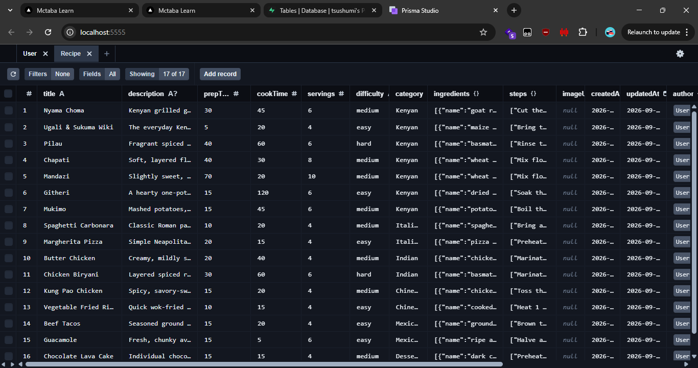
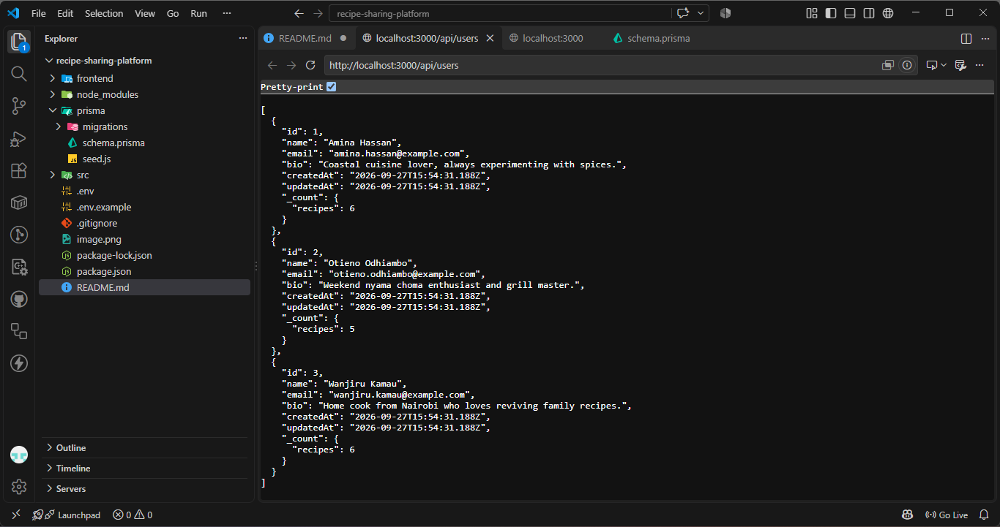
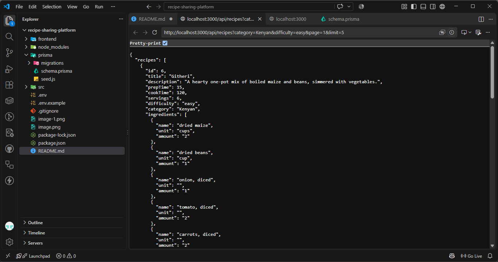
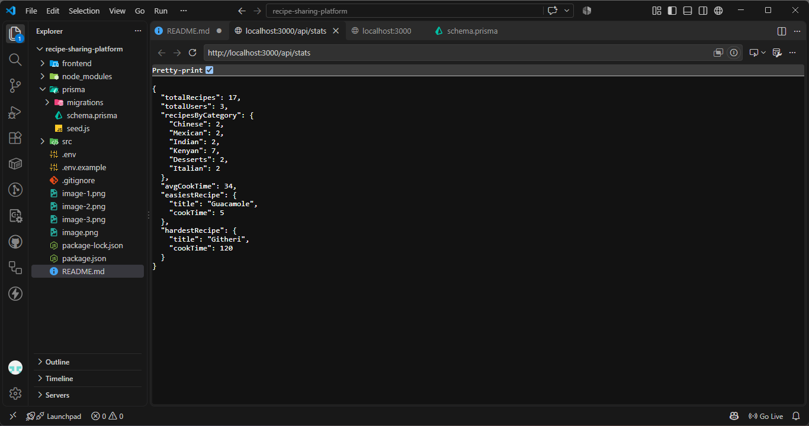

# Recipe Sharing Platform

A REST API for sharing recipes, built with Express, Prisma and PostgreSQL. Seeded
with 7 Kenyan recipes (Nyama Choma, Ugali & Sukuma Wiki, Pilau, Chapati, Mandazi,
Githeri, Mukimo) plus 10 more across Italian, Indian, Chinese, Mexican and Desserts.

## Tech stack

- Node.js + Express
- Prisma ORM
- PostgreSQL (Supabase or Neon)
- Deployed on Railway

## 1. Setup

```bash
npm install
cp .env.example .env
# edit .env and paste your Supabase/Neon DATABASE_URL
```

## 2. Create the database schema

```bash
npx prisma migrate dev --name init
```

This creates the `User` and `Recipe` tables and generates the Prisma client.

## 3. Seed the database

```bash
npm run seed
```

Seeds 3 users and 17 recipes. Re-running it clears and re-seeds the data.

Verify with Prisma Studio:

```bash
npm run studio
```


## 4. Run the server

```bash
npm run dev     # auto-restarts on file changes
# or
npm start
```

The API runs at `http://localhost:3000` by default.

## API Reference

| Method | Endpoint                             | Description |
|--------|--------------------------------------|-------------|
| POST   | `/api/users`                         | Register a new user (`name`, `email`, `bio?`) |
| GET    | `/api/users`                         | List all users with recipe count |
| GET    | `/api/users/:id`                     | Get a single user with their recipes |
| POST   | `/api/recipes`                       | Create a new recipe (requires `authorId`) |
| GET    | `/api/recipes`                       | List recipes (filters below) |
| GET    | `/api/recipes/:id`                   | Get a single recipe with author details, `avgRating` and `ratingCount` |
| PUT    | `/api/recipes/:id`                   | Update a recipe |
| DELETE | `/api/recipes/:id`                   | Delete a recipe |
| GET    | `/api/categories`                    | List unique categories with recipe counts |
| GET    | `/api/stats`                         | Aggregate stats: totals, recipes by category, avg cook time, easiest/hardest |
| POST   | `/api/users/:id/favorites`           | Add a recipe to favorites (`recipeId`) |
| GET    | `/api/users/:id/favorites`           | Get a user's favorite recipes |
| DELETE | `/api/users/:id/favorites/:recipeId` | Remove a favorite |
| POST   | `/api/recipes/:id/ratings`           | Rate a recipe 1-5 (`userId`, `value`) &mdash; re-rating updates the existing score |

### Query parameters for `GET /api/recipes`

| Parameter | Description | Example |
|---|---|---|
| `category` | Filter by category | `?category=Kenyan` |
| `search` | Search by title (case-insensitive) | `?search=pilau` |
| `difficulty` | Filter by difficulty | `?difficulty=easy` |
| `maxCookTime` | `cookTime <= value` | `?maxCookTime=30` |
| `page` | Page number (default 1) | `?page=2` |
| `limit` | Results per page (default 10) | `?limit=5` |
| `ingredient` | (stretch) filter by ingredient name | `?ingredient=maize flour` |

### Example requests

```bash
curl -X POST http://localhost:3000/api/users \
  -H "Content-Type: application/json" \
  -d '{"name":"Wanjiru Kamau","email":"wanjiru@example.com","bio":"Home cook"}'

  

curl "http://localhost:3000/api/recipes?category=Kenyan&difficulty=easy&page=1&limit=5"



curl -X PUT http://localhost:3000/api/recipes/1 \
  -H "Content-Type: application/json" \
  -d '{"servings":8}'

 # -> {"id":1,"title":"Nyama Choma","description":"Kenyan grilled goat meat, seasoned simply and cooked slow over charcoal. The king of weekend gatherings.","prepTime":30,"cookTime":45,"servings":8,"difficulty":"medium","category":"Kenyan","ingredients":[{"name":"goat ribs","unit":"kg","amount":"1.5"},{"name":"lemons, juiced","unit":"","amount":"2"},{"name":"salt","unit":"tsp","amount":"2"},{"name":"black pepper","unit":"tsp","amount":"1"},{"name":"garlic, minced","unit":"cloves","amount":"4"}],"steps":["Cut the goat meat into large pieces, keeping some bone in for flavor.","Season generously with salt, pepper, garlic and lemon juice.","Marinate for at least 30 minutes at room temperature.","Light charcoal and let it burn down to a white-grey ash.","Grill the meat, turning every 5-7 minutes, for 30-45 minutes until charred and cooked through.","Rest for a few minutes, chop into bite-sized pieces, and serve with ugali and kachumbari."],"imageUrl":null,"createdAt":"2026-09-27T15:54:33.503Z","updatedAt":"2026-09-27T16:08:49.325Z","authorId":2,"author":{"id":2,"name":"Otieno Odhiambo","email":"otieno.odhiambo@example.com"}}

curl -X DELETE http://localhost:3000/api/recipes/1


curl -X POST http://localhost:3000/api/users/1/favorites \
  -H "Content-Type: application/json" -d '{"recipeId":3}'

curl -X POST http://localhost:3000/api/recipes/3/ratings \
  -H "Content-Type: application/json" -d '{"userId":1,"value":5}'

curl http://localhost:3000/api/stats
```



## Frontend (React + Vite + Tailwind)

A small React app lives in `frontend/`: a home page with a recipe grid,
search, category filter and pagination, plus a recipe detail page with
ingredients, steps and average rating.

```bash
cd frontend
npm install
cp .env.example .env
# edit .env if your API isn't running on localhost:3000
npm run dev
```

The dev server runs at `http://localhost:5173` and talks to the API via
`VITE_API_URL`.

